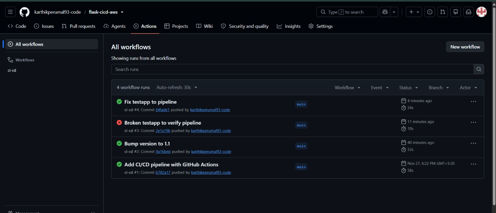
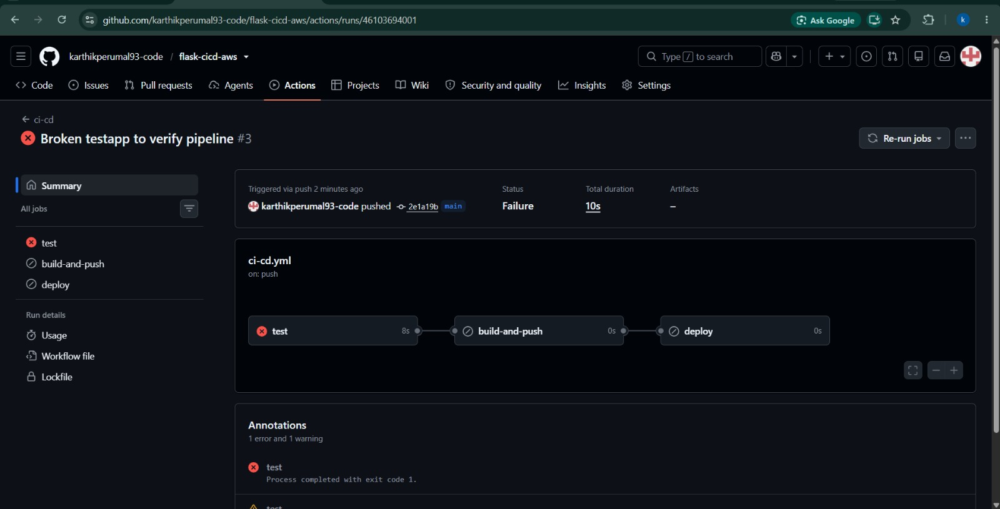
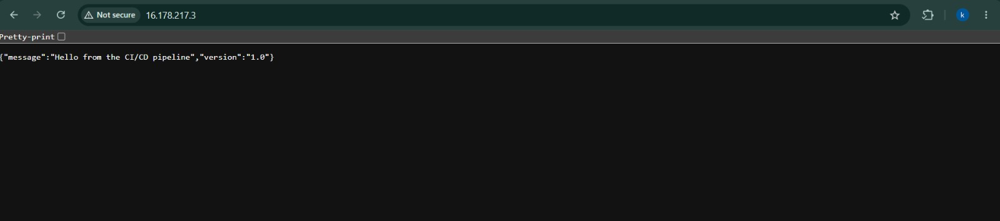

# flask-cicd-aws
CI/CD pipeline with GitHub Actions, Docker and AWS EC2

# Flask CI/CD Pipeline on AWS

A CI/CD pipeline that tests, containerizes and deploys a Python Flask app to an AWS EC2 instance on every push to `main`.

## Architecture


## Tech stack

Python (Flask, Gunicorn), pytest, Docker, Docker Hub, GitHub Actions, AWS EC2 (Ubuntu 24.04)

## How it works

1. A push to `main` triggers the workflow in `.github/workflows/ci-cd.yml`.
2. **test:** installs dependencies and runs pytest. A failure stops the pipeline.
3. **build-and-push:** builds the Docker image and pushes it to Docker Hub, tagged with the commit SHA and `latest`.
4. **deploy:** connects to the EC2 instance over SSH, pulls the new image, replaces the running container and starts the new one.

## Key design points

- Images are tagged with the commit SHA, so every deployment maps to an exact commit and can be rolled back.
- Credentials (Docker Hub token, SSH key, host) are stored in GitHub Secrets and never committed.
- Failing tests block build and deployment.
- The container restarts automatically if the server reboots (`--restart unless-stopped`).

## Required GitHub Secrets

`DOCKERHUB_USERNAME`, `DOCKERHUB_TOKEN`, `EC2_HOST`, `EC2_USER`, `EC2_SSH_KEY`

## Run locally

```bash
docker build -t flask-cicd .
docker run -d -p 5000:5000 flask-cicd
curl http://localhost:5000/health
```

## Screenshots





## Rollback

Run a previous image tag on the server:

```bash
docker stop flask-app && docker rm flask-app
docker run -d --name flask-app -p 80:5000 <dockerhub-username>/flask-cicd:<previous-sha>
```

## Known limitations and future improvements

- SSH (port 22) is open to the internet because GitHub-hosted runners use changing IP addresses. A production setup would use AWS Systems Manager or a self-hosted runner.
- No HTTPS. The next step would be a domain, a reverse proxy or a load balancer with a certificate.
- No staging environment or automated rollback on a failed health check.
- Infrastructure was created manually. It is provisioned as code in the companion Terraform and Ansible project.
